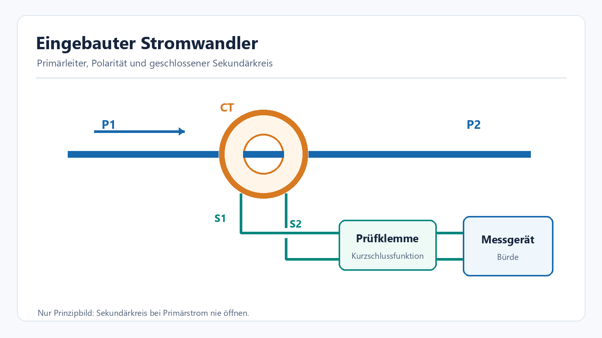
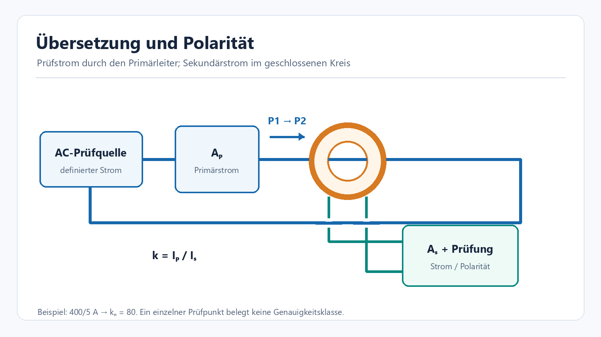
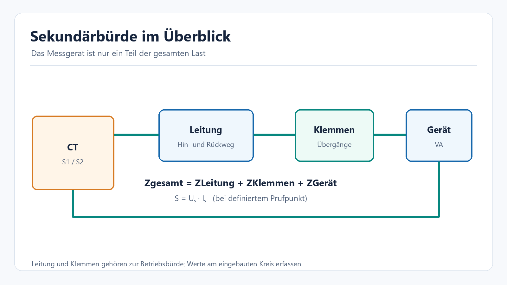
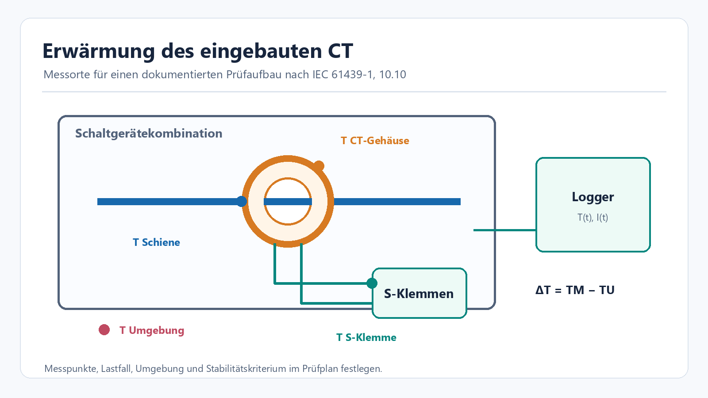

<!-- Generated by obsidian_vault/scripts/export-to-wiki.mjs. Do not edit here. -->
---
title: Stromwandler in IEC-61439-Schaltgerätekombinationen prüfen
description: Praxisleitfaden für Einbau, Übersetzung, Polarität, Bürde und Erwärmungsmessung eingebauter Stromwandler.
---

# Stromwandler in Schaltgerätekombinationen prüfen {#stromwandler-in-schaltgerätekombinationen-prüfen}

Ein Stromwandler (Current Transformer, **CT**) macht einen großen Wechselstrom für Messgerät oder Schutzrelais nutzbar. In einer Niederspannungs-Schaltgerätekombination reicht es nicht, nur den aufgedruckten Wandlerfaktor abzulesen: **Einbau, Verdrahtung, angeschlossene Bürde und Erwärmung** bestimmen, ob der Messkreis als Ganzes funktioniert.

## Welche Norm beantwortet welche Frage? {#welche-norm-beantwortet-welche-frage}

| Frage | Maßgeblicher Rahmen | Bedeutung für die Prüfung |
| --- | --- | --- |
| Ist die **Schaltgerätekombination** mit eingebautem Wandler konstruktiv und thermisch geeignet? | [IEC 61439-1:2020](https://webstore.iec.ch/en/publication/32338) **zusammen mit dem zutreffenden Produktteil**, bei Energie-Schaltgerätekombinationen typischerweise [IEC 61439-2:2020](https://webstore.iec.ch/en/publication/30043) | Einbau und Erwärmung gehören zum Bauartnachweis der gesamten Anordnung. Abschnitt 10.10 betrifft die Temperaturerhöhung. |
| Erfüllt der **induktive Stromwandler selbst** seine spezifizierten Eigenschaften? | [IEC 61869-2:2012](https://webstore.iec.ch/en/publication/6050) zusammen mit IEC 61869-1 | Übersetzung, Genauigkeitsklasse, Bürde und gegebenenfalls Schutzwandler-Verhalten werden gegen Typdaten und geeignete Prüfverfahren beurteilt. |
| Sind **Anschluss und Zuordnung** im fertigen Feld richtig? | Schaltplan, Prüfplan, Herstellerangaben | Primär-/Sekundärzuordnung, Polarität und angeschlossenes Gerät praktisch kontrollieren. Solche Funktionskontrollen ersetzen keinen vollständigen Genauigkeits- oder Bauartnachweis. |

Diese Seite ist ein **Arbeitsmodell für Messplanung und Dokumentation**. Verbindliche Grenzwerte, zulässige Nachweiswege und Prüfschritte ergeben sich aus der aktuellen Normausgabe, dem Produktteil und den Herstellerunterlagen des konkreten Aufbaus. Die Skizzen sind selbst erstellt und bewusst vereinfacht.

## 1. Messkreis verstehen, bevor gemessen wird {#1-messkreis-verstehen-bevor-gemessen-wird}

Die durch den Wandler geführte Schiene ist hier die **Primärseite**. Ihre Richtung ist als **P1 → P2** markiert. Der Sekundärkreis führt von **S1** über eine dafür vorgesehene Kurzschluss-/Prüfklemme zum Messgerät oder Relais und zurück nach **S2**. Beschriftungen können je nach Hersteller abweichen; der Anschlussplan des konkreten CT ist maßgeblich.

**Wichtig:** Bei fließendem Primärstrom darf die Sekundärseite eines induktiven Stromwandlers nicht offen sein. Vor dem Trennen eines Messgeräts muss der Sekundärkreis mit einer geeigneten Kurzschlusseinrichtung zuverlässig geschlossen werden. Das ist eine Voraussetzung für die sichere Prüfanordnung, keine optionale Messmethode. [Schneider Electric: CT-Kurzschlussklemmen](https://www.se.com/us/en/faqs/FA125574/) · [Schneider Electric: Installation und Polarität](https://www.se.com/in/en/faqs/FA219147/)

Vor einer Messung gehören mindestens diese Angaben in den Prüfplan:

- CT-Typ, Herstellerdaten, Seriennummer, Verhältnis (z. B. **400/5 A**), Nennfrequenz, Mess- oder Schutzklasse und Nennbürde;
- Einbauort und Richtung **P1/P2**, Zuordnung der **S1/S2**-Leitungen zu Phase und Messkanal;
- tatsächliche Sekundärleitung, Querschnitt, Leitungslänge, Prüfklemme und angeschlossene Geräte;
- vorgesehene Betriebsströme und Gruppenkonfiguration der Schaltgerätekombination sowie die thermisch kritischen Nachbarbauteile.

## 2. Übersetzung und Polarität kontrollieren {#2-übersetzung-und-polarität-kontrollieren}

Bei einer **Primärstromeinspeisung** führt ein geeignetes Prüfgerät einen definierten Wechselstrom durch den Wandler. Ein Messgerät erfasst den Primärstrom, ein zweites den Sekundärstrom im **geschlossenen** Messkreis. Aus den Effektivwerten entsteht ein Plausibilitätswert `k_mess = I_p / I_s`. Die Polaritätskontrolle berücksichtigt zusätzlich die Richtung bzw. Phasenlage; dazu ist ein passendes Prüfverfahren erforderlich. [OMICRON: CT-Prüfung durch Primäreinspeisung](https://www.omicronenergy.com/download/document/EE00F73F-3E53-4DA6-B80F-A0067AAF42A8/)

**Rechenbeispiel, idealisiert:** Bei **400/5 A** ist das Nennverhältnis `k_n = 80`. Bei `I_p = 320 A` wäre `I_s ≈ 4 A` zu erwarten. Eine Abweichung im realen Aufbau kann von Wandlerfehler, Bürde, Messgerät, Magnetisierung oder Verdrahtung kommen. **Ein einzelner Punkt bei 320 A belegt keine Genauigkeitsklasse.** Dafür müssen die spezifizierten Strom- und Bürdebedingungen mit geeigneter Referenztechnik untersucht werden. [IEC 61869-2](https://webstore.iec.ch/en/publication/6050) · [OMICRON: Umfang von CT-Prüfungen](https://www.omicronenergy.com/en/products/ct-analyzer)

Eine reine **Sekundäreinspeisung** in den nachgeschalteten Messkreis prüft vor allem Verdrahtung, Anzeige oder Relaisfunktion. Sie beweist allein weder die Primärzuordnung noch das Wandlerverhältnis des eingebauten CT. Bei abweichendem Vorzeichen oder unerwartetem Phasenstrom zuerst P1/P2-Richtung, S1/S2 und Kanalzuordnung anhand des Schaltplans kontrollieren.

## 3. Bürde und Sekundärleitung bewerten {#3-bürde-und-sekundärleitung-bewerten}

Die **Bürde** ist die gesamte Impedanz, die der Wandler auf seiner Sekundärseite treiben muss: Messgerät oder Relais **plus** Hin- und Rückleitung, Klemmen und Übergänge. Bei sinusförmiger Messung am definierten Arbeitspunkt gilt für die Scheinleistung näherungsweise `S = U_s · I_s` in VA. Für eine rein ohmsche Ersatzbürde gilt `S = I_s² · R_gesamt`.

**Beispiel, nur zur Anschauung:** Ein 5-A-Kreis mit insgesamt `0,20 Ω` ohmscher Bürde benötigt `U_s = 1,0 V` und `S = 5 VA`. Derselbe Widerstand verursacht bei 1 A nur `0,2 VA`. Die reale Beurteilung muss die Nennbürde und Genauigkeitsklasse **des konkreten Wandlers** sowie Frequenz und Phasenlage berücksichtigen. Zu große Bürde kann Messfehler und frühere Sättigung begünstigen. [Schneider Electric: CT-Auswahl und Bürde](https://ckm-content.se.com/ckmContent/sfc/servlet.shepherd/document/download/0691H00000FJlVkQAL) · [OMICRON: Bürde und Wandlertests](https://www.omicronenergy.com/en/products/ct-analyzer)

Für eine belastbare Prüfung Messgerät, Leitungsführung und Klemmen im **tatsächlich eingebauten Zustand** erfassen. Eine Widerstandsmessung am spannungsfreien, korrekt freigeschalteten Kreis kann Verdrahtungsfehler aufdecken; sie ersetzt keine Bürde- und Genauigkeitsmessung bei Nennfrequenz.

## 4. Variante: Erwärmungsmessung mit Temperaturfühler {#4-variante-erwärmungsmessung-mit-temperaturfühler}

Der thermische Nachweis nach **IEC 61439-1, 10.10** betrifft die **Schaltgerätekombination** unter festgelegten Belastungs- und Einbaubedingungen. Ein CT sitzt dabei am Strompfad im warmen Innenraum: Eigenerwärmung, Abwärme der Schiene und benachbarte Geräte können zusammenwirken. Die aktuelle Ausgabe der IEC 61439-1 stellt die Erwärmungsbewertung in den Zusammenhang des Gruppen-Bemessungsstroms. [IEC 61439-1:2020](https://webstore.iec.ch/en/publication/32338)

Bei einer Prüfung mit Strom werden die im Prüfplan festgelegten Stromkreise belastet. **Temperaturfühler** erfassen beispielhaft die zugängliche CT-Oberfläche, die benachbarte Schiene oder Verbindung, die Sekundärklemme und die Umgebungsluft. Positionen so dokumentieren, dass spätere Wiederholungen dieselben Stellen treffen. Die Fühler dürfen Isolation, Luftstrecken, Kühlung oder den normalen Einbauzustand nicht verändern. Eine Oberflächentemperatur ist **nicht automatisch** die Wicklungstemperatur im Inneren des CT.

Die Temperaturerhöhung einer Messstelle ist `ΔT = T_Messstelle − T_Umgebung`. Strom, Zeit, Umgebung und alle Temperaturkanäle gemeinsam aufzeichnen, bis das im Prüfplan definierte thermische Stabilitätskriterium erreicht ist. Gegen die **für den jeweiligen Messpunkt anwendbaren** Grenzwerte und Herstellerangaben bewerten; hier wird bewusst kein pauschaler CT-Grenzwert angegeben. Der relevante Produktteil und der vereinbarte Nachweisweg gehören in den Bericht. [IEC 61439-2:2020](https://webstore.iec.ch/en/publication/30043) · [ABB: Erwärmungsnachweis in Schaltgerätekombinationen](https://library.e.abb.com/public/32f98df19e5849e1b6b5d6172e00be73/2CPC000313B0201.pdf)

**Fühlerwahl und Anschluss:** Ob Thermoelement, Pt100/Pt1000 oder ein anderer Sensor geeignet ist, hängt von Temperaturbereich, Genauigkeit, Kontakt und elektrischer Einbausituation ab. Die Grundlagen und Schaltbilder stehen auf [Temperatursensoren: Typen und Messschaltungen](Temperatursensoren.md). Für eine IR-Aufnahme zusätzlich Emissionsgrad, Sichtfeld und reflektierende Schienenoberflächen beachten; sie ist kein Ersatz für einen sauber platzierten Kontaktfühler, wenn dieser Messpunkt gefordert ist.

## Kompakter Prüfablauf {#kompakter-prüfablauf}

| Schritt | Ergebnis, das im Protokoll stehen sollte |
| --- | --- |
| 1. Unterlagen und Aufbau abgleichen | Normausgabe + Produktteil, CT-Datenblatt, Schaltplan, Einbauposition, Prüfstrom und Grenzwerte |
| 2. Sekundärkreis sicher und eindeutig herstellen | S1/S2, Prüfklemme, Bürde und Messkanal dokumentiert; kein offener CT-Sekundärkreis bei Primärstrom |
| 3. Funktion prüfen | Gemessene Primär-/Sekundärwerte, Zuordnung und Polarität mit Prüfgerät und Messunsicherheit |
| 4. Bürde prüfen | Angeschlossene Geräte, Leitung, Klemmen sowie gemessene oder begründet berechnete Gesamtbürde |
| 5. Erwärmung beurteilen | Messstellenfoto oder -skizze, Stromverlauf, Umgebung, Zeitreihen, Stabilität und Vergleich mit anwendbaren Grenzen |
| 6. Abweichungen bewerten | Ursache, Korrektur und nötige Wiederholungsprüfung festhalten |

**Merksatz:** Ein korrekter Anzeigewert sagt etwas über den Messkreis am geprüften Punkt aus. Er beweist weder allein die Wandlerklasse noch die thermische Eignung der gesamten Schaltgerätekombination.

### Quellen und Einordnung {#quellen-und-einordnung}

Die Normtexte sind urheberrechtlich geschützt. Dieser Artikel enthält **eigene Formulierungen, Rechenbeispiele und Skizzen**; er gibt keine Normtabellen wieder. Für einen formalen Nachweis sind die lizenzierten Normausgaben und die Herstellerunterlagen des eingesetzten Wandlers maßgeblich: [IEC 61439-1](https://webstore.iec.ch/en/publication/32338), [IEC 61439-2](https://webstore.iec.ch/en/publication/30043), [IEC 61869-2](https://webstore.iec.ch/en/publication/6050).
