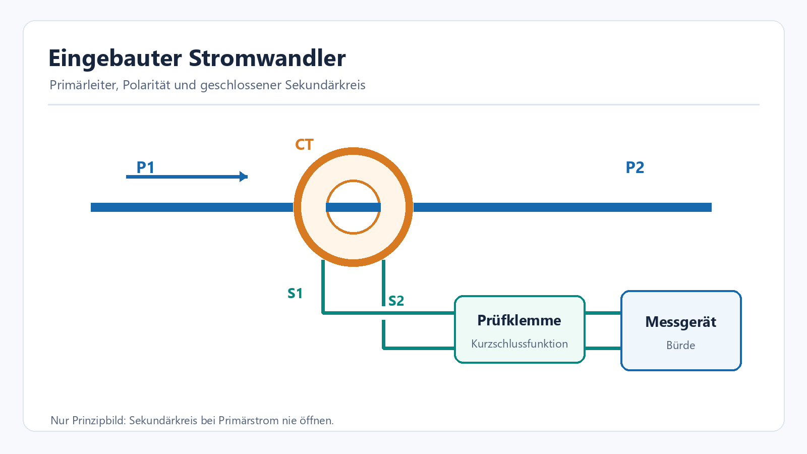
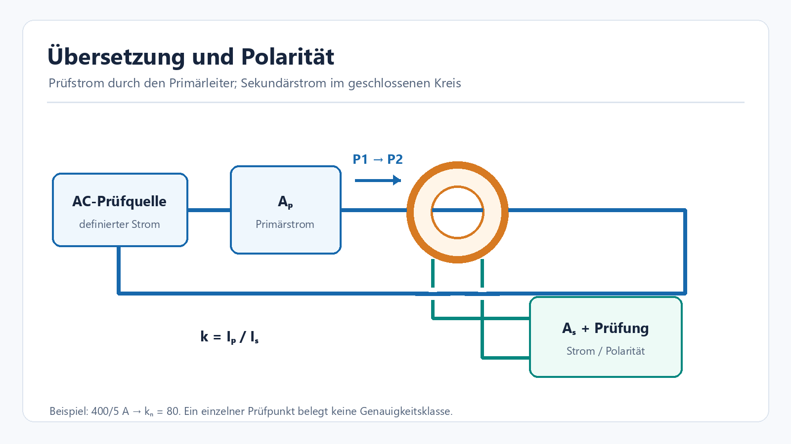
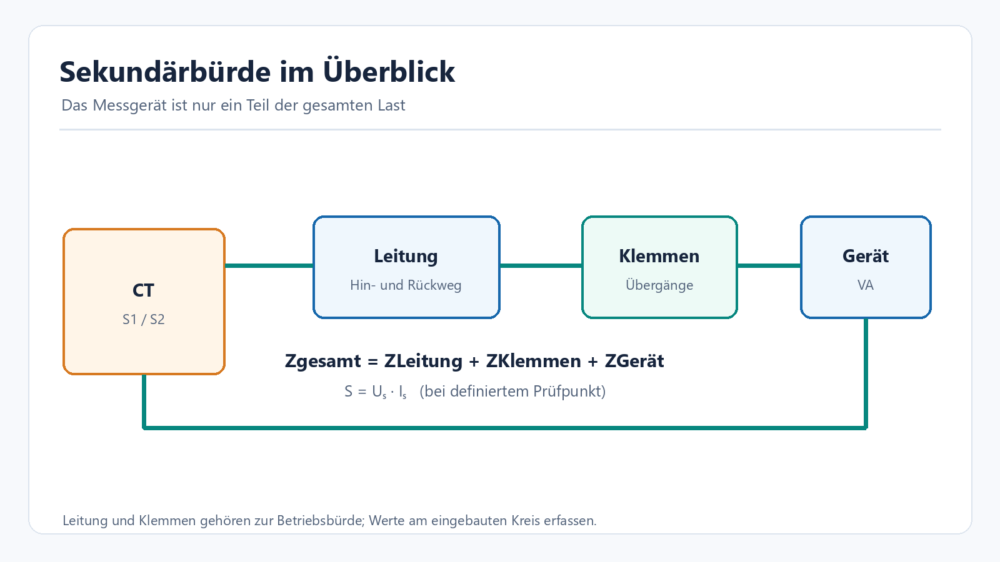
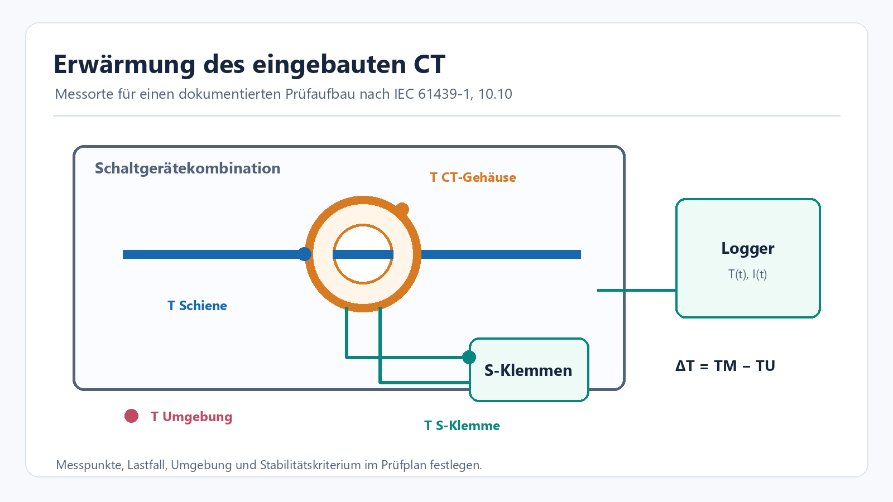

<!-- Generated by obsidian_vault/scripts/export-to-wiki.mjs. Do not edit here. -->
---
title: Stromwandler in IEC-61439-Schaltgerätekombinationen prüfen
description: Praxisleitfaden für Einbau, Übersetzung, Polarität, Bürde, Oberflächentemperatur und mittlere Wicklungstemperatur aus Kalt- und Warmwiderstand.
---

# Stromwandler in Schaltgerätekombinationen prüfen {#stromwandler-in-schaltgerätekombinationen-prüfen}

Ein Stromwandler (Current Transformer, **CT**) macht einen großen Wechselstrom für Messgerät oder Schutzrelais nutzbar. In einer Niederspannungs-Schaltgerätekombination reicht es nicht, nur den aufgedruckten Wandlerfaktor abzulesen: **Einbau, Verdrahtung, angeschlossene Bürde und Erwärmung** bestimmen, ob der Messkreis als Ganzes funktioniert.

## Welche Norm beantwortet welche Frage? {#welche-norm-beantwortet-welche-frage}

| Frage | Maßgeblicher Rahmen | Bedeutung für die Prüfung |
| --- | --- | --- |
| Ist die **Schaltgerätekombination** mit eingebautem Wandler konstruktiv und thermisch geeignet? | [IEC 61439-1:2020](https://webstore.iec.ch/en/publication/32338) **zusammen mit dem zutreffenden Produktteil**, bei Energie-Schaltgerätekombinationen typischerweise [IEC 61439-2:2020](https://webstore.iec.ch/en/publication/30043) | Einbau und Erwärmung gehören zum Bauartnachweis der gesamten Anordnung. Abschnitt 10.10 betrifft die Temperaturerhöhung. |
| Erfüllt der **induktive Stromwandler selbst** seine spezifizierten Eigenschaften? | [IEC 61869-2:2012](https://webstore.iec.ch/en/publication/6050) zusammen mit IEC 61869-1 | Übersetzung, Genauigkeitsklasse, Bürde und gegebenenfalls Schutzwandler-Verhalten werden gegen Typdaten und geeignete Prüfverfahren beurteilt. |
| Wie warm wird die **Wicklung im Stromwandler**? | Widerstandsänderungsmethode, siehe IEC 61869-2:2012, 7.2.2, soweit für den Wandler anwendbar | Mittlere Wicklungstemperatur aus Kalt- und Warmwiderstand; getrennt von der Messung zugänglicher Oberflächen. |
| Sind **Anschluss und Zuordnung** im fertigen Feld richtig? | Schaltplan, Prüfplan, Herstellerangaben | Primär-/Sekundärzuordnung, Polarität und angeschlossenes Gerät praktisch kontrollieren. Solche Funktionskontrollen ersetzen keinen vollständigen Genauigkeits- oder Bauartnachweis. |

Für Niederspannungs-Messwandler den konkreten Anwendungsbereich der Produktnorm und deren Ausgabe prüfen: [IEC 61869-1:2023](https://webstore.iec.ch/en/publication/34049) grenzt Niederspannungsanwendungen ab und verweist dafür auf IEC 61869-201. Die Widerstandsmethode wird hier als physikalisches Messverfahren und als möglicher Bestandteil der Prüfplanung beschrieben; sie ist nicht pauschal als zusätzliche Pflichtprüfung für jede IEC-61439-Schaltgerätekombination zu verstehen.

Diese Seite ist ein **Arbeitsmodell für Messplanung und Dokumentation**. Verbindliche Grenzwerte, zulässige Nachweiswege und Prüfschritte ergeben sich aus der aktuellen Normausgabe, dem Produktteil und den Herstellerunterlagen des konkreten Aufbaus. Die Skizzen sind selbst erstellt und bewusst vereinfacht.

## 1. Messkreis verstehen, bevor gemessen wird {#1-messkreis-verstehen-bevor-gemessen-wird}

Die durch den Wandler geführte Schiene ist hier die **Primärseite**. Ihre Richtung ist als **P1 → P2** markiert. Der Sekundärkreis führt von **S1** über eine dafür vorgesehene Kurzschluss-/Prüfklemme zum Messgerät oder Relais und zurück nach **S2**. Beschriftungen können je nach Hersteller abweichen; der Anschlussplan des konkreten CT ist maßgeblich.

**Wichtig:** Bei fließendem Primärstrom darf die Sekundärseite eines induktiven Stromwandlers nicht offen sein. Vor dem Trennen eines Messgeräts muss der Sekundärkreis mit einer geeigneten Kurzschlusseinrichtung zuverlässig geschlossen werden. Das ist eine Voraussetzung für die sichere Prüfanordnung, keine optionale Messmethode. [Schneider Electric: CT-Kurzschlussklemmen](https://www.se.com/us/en/faqs/FA125574/) · [Schneider Electric: Installation und Polarität](https://www.se.com/in/en/faqs/FA219147/)

Vor einer Messung gehören mindestens diese Angaben in den Prüfplan:

- CT-Typ, Herstellerdaten, Seriennummer, Verhältnis (z. B. **400/5 A**), Nennfrequenz, Mess- oder Schutzklasse und Nennbürde;
- Einbauort und Richtung **P1/P2**, Zuordnung der **S1/S2**-Leitungen zu Phase und Messkanal;
- tatsächliche Sekundärleitung, Querschnitt, Leitungslänge, Prüfklemme und angeschlossene Geräte;
- vorgesehene Betriebsströme und Gruppenkonfiguration der Schaltgerätekombination sowie die thermisch kritischen Nachbarbauteile.

## 2. Übersetzung und Polarität kontrollieren {#2-übersetzung-und-polarität-kontrollieren}

Bei einer **Primärstromeinspeisung** führt ein geeignetes Prüfgerät einen definierten Wechselstrom durch den Wandler. Ein Messgerät erfasst den Primärstrom, ein zweites den Sekundärstrom im **geschlossenen** Messkreis. Aus den Effektivwerten entsteht ein Plausibilitätswert:

$
k_{\mathrm{mess}}=\frac{I_{\mathrm{p}}}{I_{\mathrm{s}}}
$

Die Polaritätskontrolle berücksichtigt zusätzlich die Richtung bzw. Phasenlage; dazu ist ein passendes Prüfverfahren erforderlich. [OMICRON: CT-Prüfung durch Primäreinspeisung](https://www.omicronenergy.com/download/document/EE00F73F-3E53-4DA6-B80F-A0067AAF42A8/)

**Rechenbeispiel, idealisiert:** Bei **400/5 A** gilt:

$
k_{\mathrm{n}}=\frac{400\,\mathrm{A}}{5\,\mathrm{A}}=80
$

$
I_{\mathrm{s}}=\frac{I_{\mathrm{p}}}{k_{\mathrm{n}}}=\frac{320\,\mathrm{A}}{80}=4\,\mathrm{A}
$

Damit wären bei 320 A primär idealisiert 4 A sekundär zu erwarten. Eine Abweichung im realen Aufbau kann von Wandlerfehler, Bürde, Messgerät, Magnetisierung oder Verdrahtung kommen. **Ein einzelner Punkt bei 320 A belegt keine Genauigkeitsklasse.** Dafür müssen die spezifizierten Strom- und Bürdebedingungen mit geeigneter Referenztechnik untersucht werden. [IEC 61869-2](https://webstore.iec.ch/en/publication/6050) · [OMICRON: Umfang von CT-Prüfungen](https://www.omicronenergy.com/en/products/ct-analyzer)

Eine reine **Sekundäreinspeisung** in den nachgeschalteten Messkreis prüft vor allem Verdrahtung, Anzeige oder Relaisfunktion. Sie beweist allein weder die Primärzuordnung noch das Wandlerverhältnis des eingebauten CT. Bei abweichendem Vorzeichen oder unerwartetem Phasenstrom zuerst P1/P2-Richtung, S1/S2 und Kanalzuordnung anhand des Schaltplans kontrollieren.

## 3. Bürde und Sekundärleitung bewerten {#3-bürde-und-sekundärleitung-bewerten}

Die **Bürde** ist die gesamte Impedanz, die der Wandler auf seiner Sekundärseite treiben muss: Messgerät oder Relais **plus** Hin- und Rückleitung, Klemmen und Übergänge. Mit den Effektivwerten der Sekundärspannung und des Sekundärstroms ergibt sich die Scheinleistung:

$
S=U_{\mathrm{s}}\cdot I_{\mathrm{s}}
$

Für eine rein ohmsche Ersatzbürde (ohne den Eigenwiderstand der CT-Wicklung) gilt:

$
S=I_{\mathrm{s}}^2\cdot R_{\mathrm{ges}}
$

**Beispiel, nur zur Anschauung:** Ein 5-A-Kreis mit insgesamt 0,20 Ω ohmscher Bürde benötigt:

$
U_{\mathrm{s}}=5\,\mathrm{A}\cdot 0{,}20\,\Omega=1{,}0\,\mathrm{V}
$

$
S=(5\,\mathrm{A})^2\cdot 0{,}20\,\Omega=5\,\mathrm{VA}
$

Derselbe Widerstand verursacht bei 1 A nur 0,2 VA. Die reale Beurteilung muss die Nennbürde und Genauigkeitsklasse **des konkreten Wandlers** sowie Frequenz und Phasenlage berücksichtigen. Zu große Bürde kann Messfehler und frühere Sättigung begünstigen. [Schneider Electric: CT-Auswahl und Bürde](https://ckm-content.se.com/ckmContent/sfc/servlet.shepherd/document/download/0691H00000FJlVkQAL) · [OMICRON: Bürde und Wandlertests](https://www.omicronenergy.com/en/products/ct-analyzer)

Für eine belastbare Prüfung Messgerät, Leitungsführung und Klemmen im **tatsächlich eingebauten Zustand** erfassen. Eine Widerstandsmessung am spannungsfreien, korrekt freigeschalteten Kreis kann Verdrahtungsfehler aufdecken; sie ersetzt keine Bürde- und Genauigkeitsmessung bei Nennfrequenz.

## 4. Variante: Erwärmungsmessung mit Temperaturfühler {#4-variante-erwärmungsmessung-mit-temperaturfühler}

Der thermische Nachweis nach **IEC 61439-1, 10.10** betrifft die **Schaltgerätekombination** unter festgelegten Belastungs- und Einbaubedingungen. Ein CT sitzt dabei am Strompfad im warmen Innenraum: Eigenerwärmung, Abwärme der Schiene und benachbarte Geräte können zusammenwirken. Die aktuelle Ausgabe der IEC 61439-1 stellt die Erwärmungsbewertung in den Zusammenhang des Gruppen-Bemessungsstroms. [IEC 61439-1:2020](https://webstore.iec.ch/en/publication/32338)

Bei einer Prüfung mit Strom werden die im Prüfplan festgelegten Stromkreise belastet. **Temperaturfühler** erfassen beispielhaft die zugängliche CT-Oberfläche, die benachbarte Schiene oder Verbindung, die Sekundärklemme und die Umgebungsluft. Positionen so dokumentieren, dass spätere Wiederholungen dieselben Stellen treffen. Die Fühler dürfen Isolation, Luftstrecken, Kühlung oder den normalen Einbauzustand nicht verändern. Eine Oberflächentemperatur ist **nicht automatisch** die Wicklungstemperatur im Inneren des CT.

Die Temperaturerhöhung einer Messstelle ist:

$
\Delta T=T_{\mathrm{Messstelle}}-T_{\mathrm{Umgebung}}
$

Strom, Zeit, Umgebung und alle Temperaturkanäle gemeinsam aufzeichnen, bis das im Prüfplan definierte thermische Stabilitätskriterium erreicht ist. Gegen die **für den jeweiligen Messpunkt anwendbaren** Grenzwerte und Herstellerangaben bewerten; hier wird bewusst kein pauschaler CT-Grenzwert angegeben. Der relevante Produktteil und der vereinbarte Nachweisweg gehören in den Bericht. [IEC 61439-2:2020](https://webstore.iec.ch/en/publication/30043) · [ABB: Erwärmungsnachweis in Schaltgerätekombinationen](https://library.e.abb.com/public/32f98df19e5849e1b6b5d6172e00be73/2CPC000313B0201.pdf)

**Fühlerwahl und Anschluss:** Ob Thermoelement, Pt100/Pt1000 oder ein anderer Sensor geeignet ist, hängt von Temperaturbereich, Genauigkeit, Kontakt und elektrischer Einbausituation ab. Die Grundlagen und Schaltbilder stehen auf [Temperatursensoren: Typen und Messschaltungen](Temperatursensoren.md). Für eine IR-Aufnahme zusätzlich Emissionsgrad, Sichtfeld und reflektierende Schienenoberflächen beachten; sie ist kein Ersatz für einen sauber platzierten Kontaktfühler, wenn dieser Messpunkt gefordert ist.

## 5. Erwärmungsmessung über den Wicklungswiderstand (Resistance Method) {#5-erwärmungsmessung-über-den-wicklungswiderstand-resistance-method}

**Ziel:** Die mittlere Temperatur der Sekundärwicklung bestimmen, auch wenn sie im vergossenen oder geschlossenen Stromwandler nicht direkt mit einem Fühler erreichbar ist. Die Methode nutzt den temperaturabhängigen Gleichstromwiderstand des Wicklungsleiters.

Beim Erwärmungsversuch eines induktiven Stromwandlers beschreibt IEC 61869-2:2012, 7.2.2, die Bestimmung der mittleren Wicklungstemperatur anhand der Widerstandsänderung, soweit praktikabel. Bei sehr kleinen Wicklungswiderständen kommen geeignete Temperaturfühler infrage. Für den eingebauten CT sind zusätzlich die konkrete Produktnorm, Herstellerangaben und der IEC-61439-Prüfplan maßgeblich.

### 5.1 Messaufbau und Durchführung {#51-messaufbau-und-durchführung}

| Phase | Messung / Tätigkeit | Aufzeichnung |
| --- | --- | --- |
| Kaltzustand | Wandler thermisch ausgleichen lassen. Gleichstromwiderstand derselben Wicklung bzw. Anzapfung messen, vorzugsweise mit Vierleitermessung. | Kaltwiderstand, Wicklungstemperatur, Messstrom, Anschlussklemmen |
| Erwärmungsversuch | Wandler im vorgesehenen Einbauzustand mit festgelegtem Primärstrom und definierter Sekundärbürde betreiben. | Primärstrom, Bürde, Umgebung, Temperaturfühler und Stabilitätskriterium |
| Abschalten | Abschaltzeitpunkt erfassen. Prüfstrom sicher abschalten und Spannungsfreiheit feststellen. Erst dann Sekundärkreis für Widerstandsmessung umschalten. | Zeitnullpunkt, Umgebungstemperatur am Prüfende |
| Warmmessung | Möglichst früh mehrere Gleichstromwiderstände mit Zeitstempel am gleichen Klemmenpaar erfassen. | Widerstandsverlauf über der Zeit, Beginn und Dauer der Messungen |
| Auswertung | Warmwiderstand auf den Abschaltzeitpunkt zurückführen, sofern erforderlich und nach anwendbarer Prüfvorschrift. | Widerstand bei Zeitnull, mittlere Wicklungstemperatur und Temperaturerhöhung |

**Sicherheit:** Der CT-Sekundärkreis darf bei fließendem Primärstrom nicht geöffnet werden. Widerstandsmessung nur an der sicher freigeschalteten, von der Bürde und parallelen Kurzschlusspfaden getrennten Wicklung mit geeigneter Messtechnik durchführen. Bei induktiven Prüflingen auf die sichere Entladung nach DC-Messung achten; eine durch den Gleichstrom verursachte Remanenz gegebenenfalls durch ein geeignetes Entmagnetisierungsverfahren beseitigen. Die Umschaltung vorab planen und mit dem Labor-Sicherheitskonzept abstimmen.

### 5.2 Mathematisches Modell {#52-mathematisches-modell}

Die folgenden Größen beschreiben die kalte Referenzmessung und das Ende des Erwärmungsversuchs.

| Größe | Bedeutung | Einheit |
| --- | --- | --- |
| $R_{\mathrm{k}}$ | Gleichstromwiderstand der kalten Wicklung | Ω |
| $R_{\mathrm{w}}$ | Warmwiderstand der Wicklung zum Abschaltzeitpunkt | Ω |
| $\vartheta_{\mathrm{k}}$ | Mittlere Wicklungstemperatur bei der Kaltmessung | °C |
| $\vartheta_{\mathrm{w}}$ | Mittlere Wicklungstemperatur bei Versuchsende | °C |
| $\vartheta_{\mathrm{a}}$ | Maßgebliche Umgebungstemperatur bei Versuchsende | °C |
| $K$ | Materialkonstante des Wicklungsleiters | °C |

Näherung für die Temperaturabhängigkeit des Leiterwiderstands:

$
\frac{R_{\mathrm{w}}}{R_{\mathrm{k}}}
=\frac{K+\vartheta_{\mathrm{w}}}{K+\vartheta_{\mathrm{k}}}
$

Nach der mittleren Wicklungstemperatur aufgelöst:

$
\boxed{\vartheta_{\mathrm{w}}=\frac{R_{\mathrm{w}}}{R_{\mathrm{k}}}
\left(K+\vartheta_{\mathrm{k}}\right)-K}
$

Für die Temperaturerhöhung gegenüber der Umgebung am Prüfende gilt:

$
\boxed{\Delta\vartheta_{\mathrm{W}}=\vartheta_{\mathrm{w}}-\vartheta_{\mathrm{a}}}
$

Kombinierte Gleichung:

$
\Delta\vartheta_{\mathrm{W}}=
\frac{R_{\mathrm{w}}-R_{\mathrm{k}}}{R_{\mathrm{k}}}
\left(K+\vartheta_{\mathrm{k}}\right)
+\vartheta_{\mathrm{k}}-\vartheta_{\mathrm{a}}
$

Für Kupfer wird in diesem Artikel die Materialkonstante 234,5 °C verwendet. Für Aluminium sind 225 °C gebräuchlich. Werkstoff und Materialkonstante müssen zur Wicklung und zur festgelegten Prüfvorschrift passen. Die Kaltwicklungstemperatur darf nur dann mit der Umgebung gleichgesetzt werden, wenn tatsächlich thermisches Gleichgewicht vorliegt.

### 5.3 Rechenbeispiel – Kupferwicklung {#53-rechenbeispiel-kupferwicklung}

Illustrative Daten eines Stromwandlers; keine Hersteller- oder Normgrenzwerte.

| Messgröße | Wert |
| --- | ---: |
| Kaltwiderstand | 0,500 Ω |
| Kaltwicklungstemperatur | 20,0 °C |
| Warmwiderstand zum Abschaltzeitpunkt | 0,650 Ω |
| Umgebungstemperatur am Prüfende | 35,0 °C |
| Materialkonstante Kupfer | 234,5 °C |

$
\vartheta_{\mathrm{w}}=
\frac{0{,}650}{0{,}500}(234{,}5+20)-234{,}5
=96{,}35\,^\circ\mathrm{C}
$

$
\Delta\vartheta_{\mathrm{W}}=
96{,}35-35{,}0=61{,}35\,\mathrm{K}
$

**Ergebnis:** Die mittlere Wicklungstemperatur beträgt 96,35 °C, die Temperaturerhöhung gegenüber der maßgeblichen Umgebung 61,35 K. Eine Aussage zur Einhaltung der zulässigen Temperatur setzt die anwendbaren Grenzwerte voraus.

### 5.4 Rückextrapolation auf den Abschaltzeitpunkt {#54-rückextrapolation-auf-den-abschaltzeitpunkt}

Nach Abschalten des Primärstroms verändert sich die Wicklungstemperatur bereits während des Umklemmens und Messens. Deshalb ist der erste abgelesene Warmwiderstand nicht automatisch der Widerstand am Ende der Belastung.

- Mehrere Widerstandswerte in kurzen, dokumentierten Zeitabständen erfassen. Messgerät und Umschaltung so vorbereiten, dass die Verzögerung minimiert wird.
- Die Messwerte entsprechend der anwendbaren Vorschrift bzw. einem validierten Abkühlmodell auf den Abschaltzeitpunkt extrapolieren. Ein einfaches lineares Modell ist nur für einen begründeten, ausreichend kurzen Bereich zulässig, nicht pauschal für den gesamten Abkühlvorgang.
- Messverzögerung, Modell, extrapolierten Widerstand und Unsicherheit protokollieren. Falls der Verlauf keine belastbare Rückrechnung zulässt, die Messung wiederholen oder das Verfahren anpassen.

Wichtige Einflüsse: Leitungs- und Kontaktwiderstände, Eigenerwärmung durch den DC-Messstrom, induktive Einschwingzeit, verzögerte Messung, externe Wärmequellen und nicht homogen temperierte Anschlussleitungen. Die Vierleitermessung reduziert äußere Leitungsfehler, eliminiert aber nicht die Einflüsse interner Anschlussleitungen.

### 5.5 Widerstandsmethode oder Temperaturfühler? {#55-widerstandsmethode-oder-temperaturfühler}

| Merkmal | Wicklungswiderstand | Temperaturfühler |
| --- | --- | --- |
| Messgröße | Mittlere Wicklungstemperatur | Lokale Temperatur an der Fühlerposition |
| Vorteil | Auch bei unzugänglicher Wicklung nutzbar | Kontinuierliche Aufzeichnung unter Belastung |
| Grenze | Kein direkter Nachweis lokaler Hotspots; Abschaltkorrektur nötig, wenn der Warmwiderstand nicht unmittelbar erfasst wird | Zugängliche Oberfläche repräsentiert nicht zwingend die Wicklung |
| Im Prüflabor | Kalt-/Warmmessung, Temperaturberechnung und Unsicherheit | Oberfläche, Klemmen, Schienen und Umgebung während des Versuchs |

Beide Verfahren ergänzen sich. Die mittlere Wicklungstemperatur darf nicht ohne zusätzlichen Nachweis als maximale lokale Wicklungstemperatur interpretiert werden.

Vertiefung: [IEC 61869-2:2012](https://webstore.iec.ch/en/publication/6050), Abschnitt 7.2.2; [Temperature Rise Testing of Current Transformers: Improvement in Test Method (Chalmers)](https://publications.lib.chalmers.se/records/fulltext/173228/173228.pdf), mit Widerstandsmethode und Diskussion des Messverfahrens.

## Kompakter Prüfablauf {#kompakter-prüfablauf}

| Schritt | Ergebnis, das im Protokoll stehen sollte |
| --- | --- |
| 1. Unterlagen und Aufbau abgleichen | Normausgabe + Produktteil, CT-Datenblatt, Schaltplan, Einbauposition, Prüfstrom und Grenzwerte |
| 2. Sekundärkreis sicher und eindeutig herstellen | S1/S2, Prüfklemme, Bürde und Messkanal dokumentiert; kein offener CT-Sekundärkreis bei Primärstrom |
| 3. Funktion prüfen | Gemessene Primär-/Sekundärwerte, Zuordnung und Polarität mit Prüfgerät und Messunsicherheit |
| 4. Bürde prüfen | Angeschlossene Geräte, Leitung, Klemmen sowie gemessene oder begründet berechnete Gesamtbürde |
| 5a. Oberflächentemperatur messen | Messstellenfoto oder -skizze, Stromverlauf, Umgebung, Zeitreihen, Stabilität und Vergleich mit anwendbaren Grenzen |
| 5b. Wicklungstemperatur bestimmen | Kaltwiderstand, Kaltwicklungstemperatur, Warmwiderstände mit Zeitstempeln, ggf. Rückextrapolation, Materialkonstante, mittlere Wicklungstemperatur und Temperaturerhöhung; Grenzwertvergleich und Unsicherheit |
| 6. Abweichungen bewerten | Ursache, Korrektur und nötige Wiederholungsprüfung festhalten |

**Merksatz:** Ein korrekter Anzeigewert sagt etwas über den Messkreis am geprüften Punkt aus. Er beweist weder allein die Wandlerklasse noch die thermische Eignung der gesamten Schaltgerätekombination.

### Quellen und Einordnung {#quellen-und-einordnung}

Die Normtexte sind urheberrechtlich geschützt. Dieser Artikel enthält **eigene Formulierungen, Rechenbeispiele und Skizzen**; er gibt keine Normtabellen wieder. Für einen formalen Nachweis sind die lizenzierten Normausgaben und die Herstellerunterlagen des eingesetzten Wandlers maßgeblich: [IEC 61439-1](https://webstore.iec.ch/en/publication/32338), [IEC 61439-2](https://webstore.iec.ch/en/publication/30043), [IEC 61869-2](https://webstore.iec.ch/en/publication/6050).
