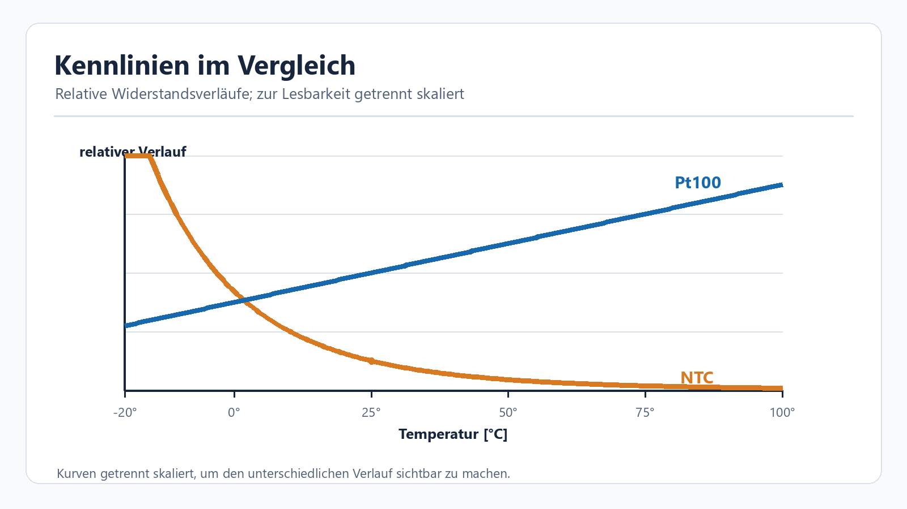
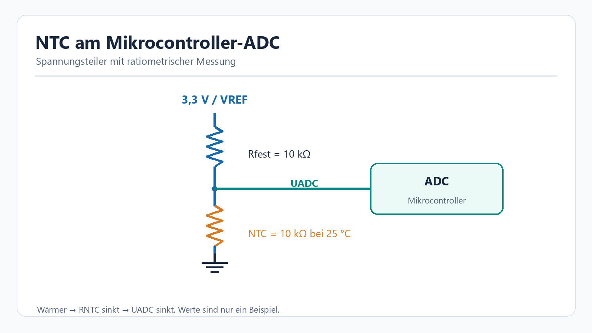
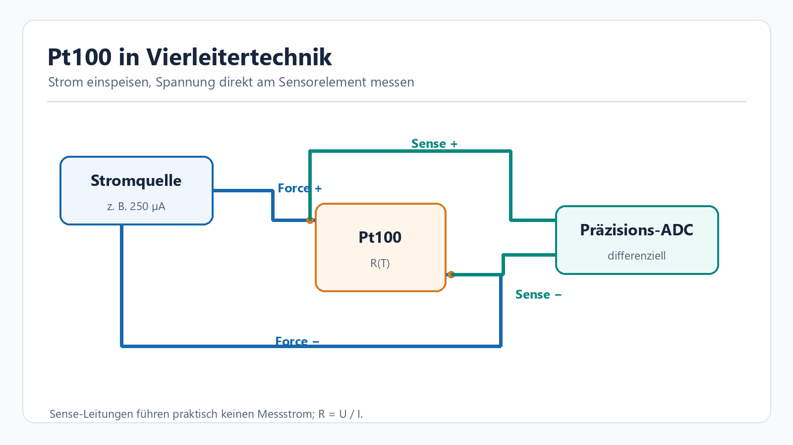
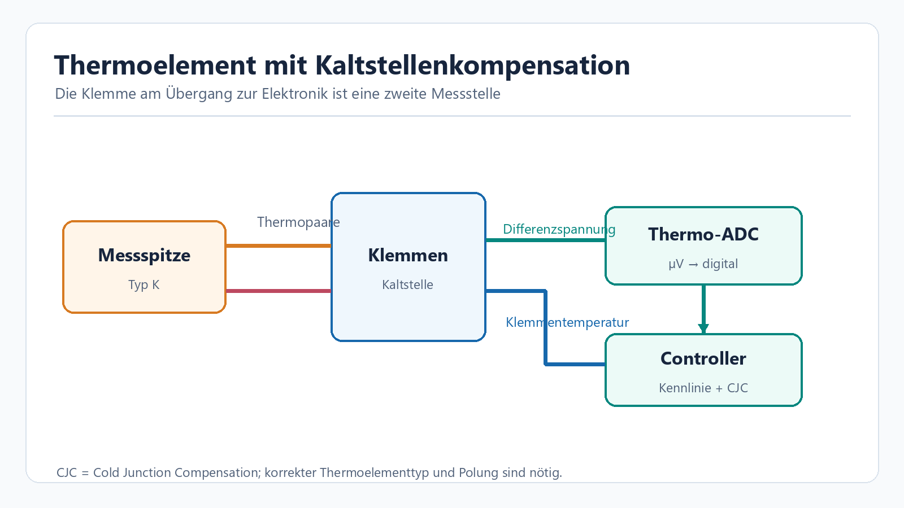
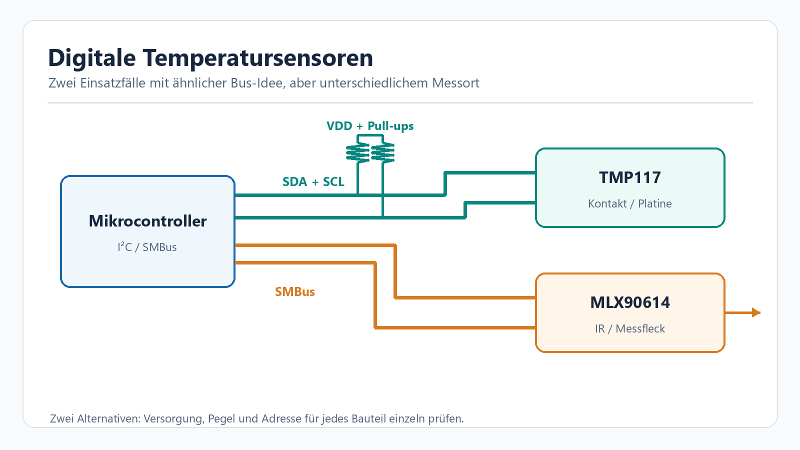

<!-- Generated by obsidian_vault/scripts/export-to-wiki.mjs. Do not edit here. -->
---
title: Temperatursensoren – Auswahl, Eigenschaften und Schaltungen
description: Vergleich von NTC, Pt100, Thermoelement, digitalen Sensoren und Infrarotmessung mit Schaltungsbeispielen und Kosten.
---

# Temperatursensoren: Welcher Typ passt zu welcher Messaufgabe? {#temperatursensoren-welcher-typ-passt-zu-welcher-messaufgabe}

Ein Temperatursensor misst immer **die Temperatur seines eigenen Messorts**. Ob dieser Wert die Temperatur des gewünschten Objekts trifft, hängt zusätzlich von Montage, Wärmeübergang, Eigenerwärmung und Auswertung ab. Ein hochgenauer Chip auf einer warmen Leiterplatte misst deshalb nicht automatisch präzise die Raumluft.

**Kurzentscheidung:** Für einen günstigen Kontaktfühler im begrenzten Bereich eignet sich oft ein **NTC**. Für stabile, reproduzierbare Prozessmessungen nimmt man häufig **Pt100/Pt1000**. Für sehr hohe Temperaturen und robuste Fühler sind **Thermoelemente** üblich. Direkt auf einer Leiterplatte ist ein **digitaler IC** bequem. Wenn kein Kontakt möglich ist, kommt **Infrarot** infrage – sofern Oberfläche und Messfleck bekannt sind.

## Vergleich auf einen Blick {#vergleich-auf-einen-blick}

| Typ | Messprinzip und Signal | Stärken | Grenzen | Typische Anwendung |
| --- | --- | --- | --- | --- |
| **NTC-Thermistor** | Widerstand sinkt mit Temperatur; ADC misst Spannung | Preiswert, klein, empfindlich um den Auslegungspunkt | Nichtlinear; Bauteiltoleranz, Leitungen und Eigenerwärmung beachten | Akku, Kühlgerät, Raum- und Geräteüberwachung |
| **Pt100 / Pt1000 (RTD)** | Platinwiderstand steigt annähernd linear; Stromquelle + ADC | Gute Langzeitstabilität, austauschbare genormte Kennlinie | Fühler und Analogschaltung teurer; Leitungsfehler, Eigenerwärmung | Anlagen, Labor, Heizung, Prozessregelung |
| **Thermoelement, z. B. Typ K** | Zwei Metalle erzeugen eine kleine Thermospannung | Hohe Temperaturen, schnelle und robuste Sonden | Kaltstellenkompensation, Verstärkung und passende Ausgleichsleitung nötig | Ofen, Abgas, Werkzeug, Schmelzprozesse |
| **Digitaler IC, z. B. TMP117** | Temperatur wird im Chip digitalisiert; I²C/SMBus | Wenig Analogaufwand, kalibrierte Varianten, mehrere Geräte am Bus | Misst Chip-/Platinenumgebung; Temperaturbereich und Gehäuse begrenzen Einsatz | Elektronik, Datenlogger, Batteriegeräte |
| **IR-Sensor, z. B. MLX90614** | Erfasst Wärmestrahlung im Sichtfeld | Berührungslos, bewegte oder schwer erreichbare Ziele | Emissionsgrad, Reflexion, Optik und Messfleck beeinflussen Ergebnis | Bewegte Teile, heiße Oberflächen, berührungslose Kontrolle |

Die Spalten sind **Bauarten**, keine Genauigkeitsgarantien. Messbereich und Unsicherheit gelten immer für das konkrete Bauteil, den Fühleraufbau und die gesamte Messkette. Ein **PTC** ist ebenfalls ein temperaturabhängiger Widerstand; schaltende PTCs werden häufig als Grenzwert- oder Übertemperaturschutz verwendet. Für kontinuierliche Messung ist die konkrete Kennlinie entscheidend.

*Schematische Kennlinien: auf den jeweiligen 25-°C-Wert bezogen und für die Darstellung unterschiedlich skaliert, keine Kalibrierdaten eines konkreten Bauteils. NTC fällt stark und nichtlinear; Pt100 steigt vergleichsweise gleichmäßig.*

## Eigenschaften und Auswahlkriterien {#eigenschaften-und-auswahlkriterien}

### Messbereich und Genauigkeit {#messbereich-und-genauigkeit}

- **Pt100** bedeutet 100 Ω bei 0 °C, **Pt1000** entsprechend 1000 Ω. Der sinnvolle Bereich hängt von Element, Schutzrohr, Anschlussleitung und Messumformer ab. Ein industrielles 4-Draht-Beispiel von Analog Devices ist für −200 bis +600 °C ausgelegt. [ADI: 4-Draht-RTD](https://www.analog.com/en/resources/reference-designs/circuits-from-the-lab/cn0382.html)
- **Typ K** hat nach NIST eine Referenzkennlinie von etwa −270 bis +1372 °C. Eine gekaufte Sonde ist oft für einen deutlich kleineren Bereich spezifiziert: Mantel, Isolation und Stecker begrenzen sie. [NIST: Thermocouple Tables](https://nvlpubs.nist.gov/nistpubs/Legacy/MONO/nistmonograph175.pdf)
- **TMP117** arbeitet laut Hersteller von −55 bis +150 °C; seine maximale Temperaturabweichung beträgt ±0,1 °C **nur im Bereich −20 bis +50 °C**. Auflösung (0,0078 °C) und Genauigkeit sind verschiedene Größen. [TI: TMP117](https://www.ti.com/product/TMP117)
- **MLX90614** kann je nach Variante Objekttemperaturen von −70 bis +380 °C erfassen. Die oft genannte Abweichung von ±0,5 °C gilt nur unter den im Datenblatt beschriebenen Bedingungen und in einem engeren Temperaturbereich. [Melexis: MLX90614-Datenblatt](https://www.melexis.com/-/media/files/documents/datasheets/mlx90614-datasheet-melexis.pdf)

### Was die Messung in der Praxis verändert {#was-die-messung-in-der-praxis-verändert}

1. **Thermischer Kontakt und Ansprechzeit:** Ein Schutzrohr schützt die Sonde, verlangsamt aber meist ihre Reaktion. Bei Kontaktmessung muss die Messstelle gut an das Ziel gekoppelt und gegen unerwünschte Umgebungseinflüsse geschützt sein.
2. **Eigenerwärmung:** NTC und RTD werden mit Strom gemessen. Zu viel Messleistung erwärmt den Sensor und verschiebt den Wert. Messstrom, Vorwiderstand und Messintervall gehören daher zur Auslegung. [TDK: NTC-Ausleseschaltung](https://www.tdk-electronics.tdk.com/download/3229242/813b1afa3fb473d7a434b927186744b2/ntc-thermistors-readout-optimization-an.pdf)
3. **Leitungswiderstand:** Bei Pt100 sind zusätzliche Ohm im Kabel spürbar. 3-Draht-Schaltungen kompensieren unter passenden Annahmen, 4-Draht-Schaltungen trennen Strom- und Spannungsleitungen. Bei Pt1000 fällt derselbe Leitungswiderstand relativ weniger ins Gewicht. [ADI: RTD-Messsysteme](https://www.analog.com/en/resources/technical-articles/rtd-measurement-system-design-essentials.html)
4. **Kaltstelle:** Ein Thermoelement misst eine Temperaturdifferenz zwischen Messspitze und Anschlussstelle. Die Temperatur der Anschlussstelle muss separat erfasst und rechnerisch kompensiert werden. [ADI: Thermoelement mit Kaltstellenmessung](https://www.analog.com/en/resources/reference-designs/circuits-from-the-lab/CN0384.html)
5. **Emissionsgrad und Sichtfeld:** Ein IR-Sensor sieht einen Messfleck, nicht einen Punkt. Glänzende Metalle reflektieren Umgebungstrahlung; eine falsche Emissionsgrad-Annahme verfälscht den Wert. Abstand und Öffnungswinkel müssen zur Zielgröße passen. [Melexis: MLX90614-Datenblatt](https://www.melexis.com/-/media/files/documents/datasheets/mlx90614-datasheet-melexis.pdf)

## Schaltungsbeispiele {#schaltungsbeispiele}

Die Bilder zeigen **Messprinzipien** für eigene Schaltungen. Versorgung, Schutz, Filter, Kalibrierung und Bauteilwerte müssen für den konkreten Sensor und ADC geprüft werden.

### 1. NTC am ADC: einfacher Spannungsteiler {#1-ntc-am-adc-einfacher-spannungsteiler}

Ein Festwiderstand und ein NTC bilden einen Spannungsteiler. Bei der gezeichneten Anordnung liegt der NTC an Masse: Wird er wärmer, sinkt sein Widerstand und damit die ADC-Spannung. Mit gleicher Versorgung als Teilerquelle und ADC-Referenz ist die Messung weitgehend **ratiometrisch**. Der Festwiderstand sollte zum interessierenden Temperaturbereich passen; 10 kΩ ist hier nur ein **Beispiel für einen 10-kΩ-NTC bei 25 °C**. Ein Kondensator am ADC-Eingang kann Störungen glätten, muss aber zur ADC-Abtastung passen. Für eine Temperaturzahl braucht die Firmware die Kennlinie des **konkreten** NTC, etwa seine Widerstandstabelle oder den B-Wert. [TDK: Auslegung und Eigenerwärmung](https://www.tdk-electronics.tdk.com/download/3229242/813b1afa3fb473d7a434b927186744b2/ntc-thermistors-readout-optimization-an.pdf)

### 2. Pt100: Vierleiter-Messung {#2-pt100-vierleiter-messung}

Eine kleine, bekannte Stromquelle treibt den Pt100 über zwei **Force-Leitungen**. Zwei getrennte **Sense-Leitungen** messen die Spannung direkt am Widerstand. Da durch die Sense-Leitungen nahezu kein Strom fließt, gehen deren Leitungswiderstände kaum in die Spannungsmessung ein. Aus `R = U / I` folgt der Widerstand; die Umrechnung in °C erfolgt mit der Pt100-Kennlinie. Ein ratiometrischer Präzisions-ADC kann Stromquellenfehler weiter verringern. Bei einfachen Zweileiter-Anschlüssen misst man den Kabelwiderstand mit. [ADI: 4-Draht-Referenzschaltung](https://www.analog.com/en/resources/reference-designs/circuits-from-the-lab/cn0382.html)

### 3. Thermoelement: Kaltstelle mitmessen {#3-thermoelement-kaltstelle-mitmessen}

Das Thermoelement liefert nur wenige Millivolt. Ein geeigneter Verstärker oder Thermoelement-ADC erfasst die Differenzspannung; ein zweiter Sensor misst die **Klemmentemperatur**. Beide Werte werden mit der Kennlinie des richtigen Thermoelementtyps zusammengeführt. Thermoelement- und Ausgleichsleitung müssen bis zur definierten Kaltstelle korrekt gepolt und typgerecht geführt sein. [ADI: Thermoelement-Referenzschaltung](https://www.analog.com/en/resources/reference-designs/circuits-from-the-lab/CN0384.html)

### 4. Digitaler Kontakt- oder IR-Sensor am I²C-Bus {#4-digitaler-kontakt--oder-ir-sensor-am-i2c-bus}

Ein Mikrocontroller liest einen digitalen Kontaktchip wie den TMP117 über **SDA/SCL**. Die beiden Busleitungen benötigen Pull-up-Widerstände zur passenden Versorgung; Adressen, Spannung und Pins sind dem Datenblatt zu entnehmen. Ein IR-Chip wie der MLX90614 benutzt eine SMBus-kompatible Schnittstelle, misst aber die Strahlung einer sichtbaren Fläche. Er muss das Ziel vollständig im Messfleck haben. **Nicht jedes Bauteil der Sensorfamilien läuft mit derselben Versorgung oder Busspannung**; die Zeichnung zeigt deshalb bewusst zwei getrennte Beispielzweige. [TI: TMP117](https://www.ti.com/product/TMP117) · [Melexis: MLX90614](https://www.melexis.com/en/documents/documentation/datasheets/datasheet-mlx90614)

## Kosten: Was kostet ein Messpunkt? {#kosten-was-kostet-ein-messpunkt}

Die folgenden **Einzelstück-Beispiele** sind Momentaufnahmen der Händlerseiten, abgerufen am **19.10.2026**, in Euro **ohne MwSt.** Sie vergleichen unterschiedliche Lieferformen: ein nacktes Bauteil ist noch kein geschützter Fühler. Preise, Verfügbarkeit und Versand können sich ändern.

| Beispiel | Bauform | Richtwert pro Stück |
| --- | --- | ---: |
| [TDK B57891M0103J000, 10-kΩ-NTC](https://www.digikey.de/de/products/detail/tdk/B57891M0103J000/739907) | einzelner Thermistor | **0,76 €** |
| [TI TMP117MAIDRVR](https://www.digikey.de/de/products/detail/texas-instruments/TMP117MAIDRVR/9685285) | digitaler SMD-Chip | **2,11 €** |
| [Melexis MLX90614ESF-BAA-000-TU](https://www.digikey.de/de/products/detail/melexis-technologies-nv/MLX90614ESF-BAA-000-TU/1647941) | IR-Chip im Metallgehäuse | **8,58 €** |
| [RS PRO Typ-K-Sonde](https://de.rs-online.com/web/p/thermoelemente/0350389) | konfektionierter Fühler | **14,18 €** |
| [RS PRO Pt100-Sonde](https://de.rs-online.com/web/p/widerstands-temperatursensoren/0350360) | Edelstahlfühler mit Leitung | **41,64 €** |

Zum **Systempreis** kommen je nach Bauart Vorwiderstand, ADC oder Messumformer, Kabel, Stecker, Schutzrohr, Einbau und gegebenenfalls Kalibrierung hinzu. Bei einem hochgenauen Messpunkt dominieren diese Posten häufig den Preis des eigentlichen Sensorelements.

## Typische Anwendungen und passende Wahl {#typische-anwendungen-und-passende-wahl}

| Situation | Gute erste Wahl | Worauf besonders achten? |
| --- | --- | --- |
| Akkupack oder Kühlfach, moderate Temperaturen | NTC | Kennlinie, gute thermische Kopplung, Diagnose bei offenem/kurzem Fühler |
| Heizungsrohr oder Prozessbehälter mit längerer Leitung | Pt1000 oder Pt100 mit 3/4 Leitern | Fühlerhülse, Leitungswiderstand, Feuchte, Messstrom |
| Ofen, Abgas, heiße Maschinenfläche | Thermoelement Typ K | Sondenmaterial, Kaltstelle, Leitungs- und Stecker-Typ |
| Leiterplatten- oder Gehäusetemperatur | Digitaler IC | Abstand zu Wärmequellen, Luftstrom, Busspannung, Eigenerwärmung |
| Bewegtes Band oder nicht berührbares Objekt | IR-Sensor | Emissionsgrad, Reflexion, Messfleck und Sichtfenster |

**Praktische Auswahlfrage:** *Welche Temperatur soll geregelt werden – die des Mediums, der Oberfläche, der Luft oder der Elektronik?* Erst danach Messbereich, zulässigen Fehler, Ansprechzeit, Einbauort und Budget festlegen. Für kritische Regelung ist eine Prüfung am eingebauten Messpunkt aussagekräftiger als allein die Genauigkeitsangabe im Sensordatenblatt.
